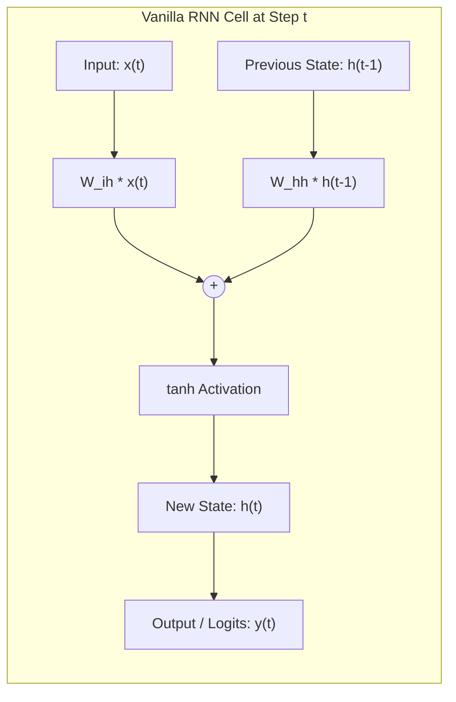
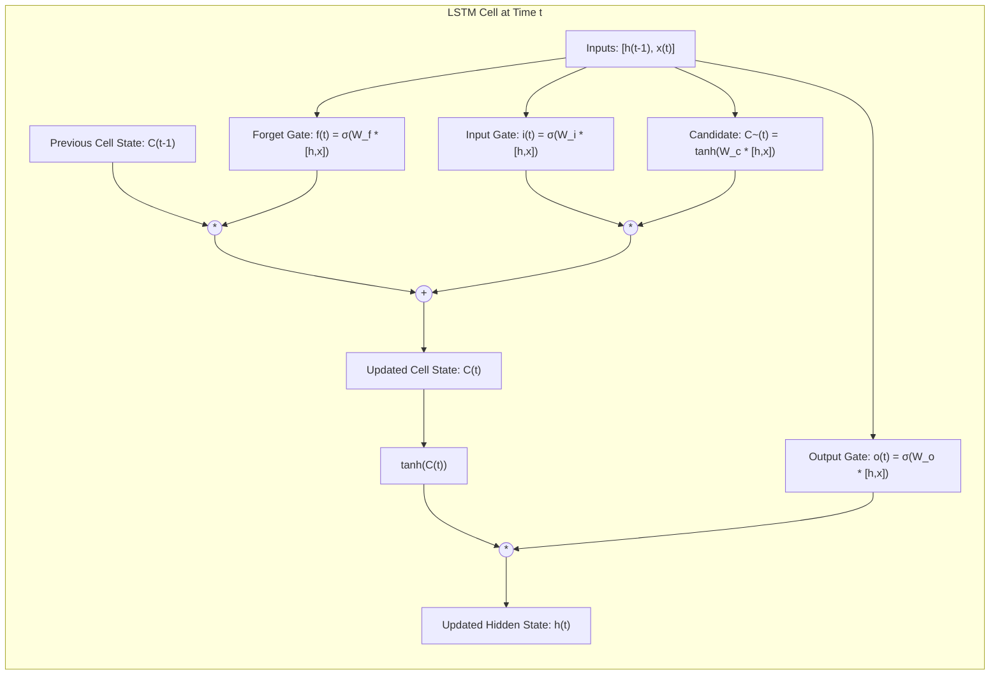
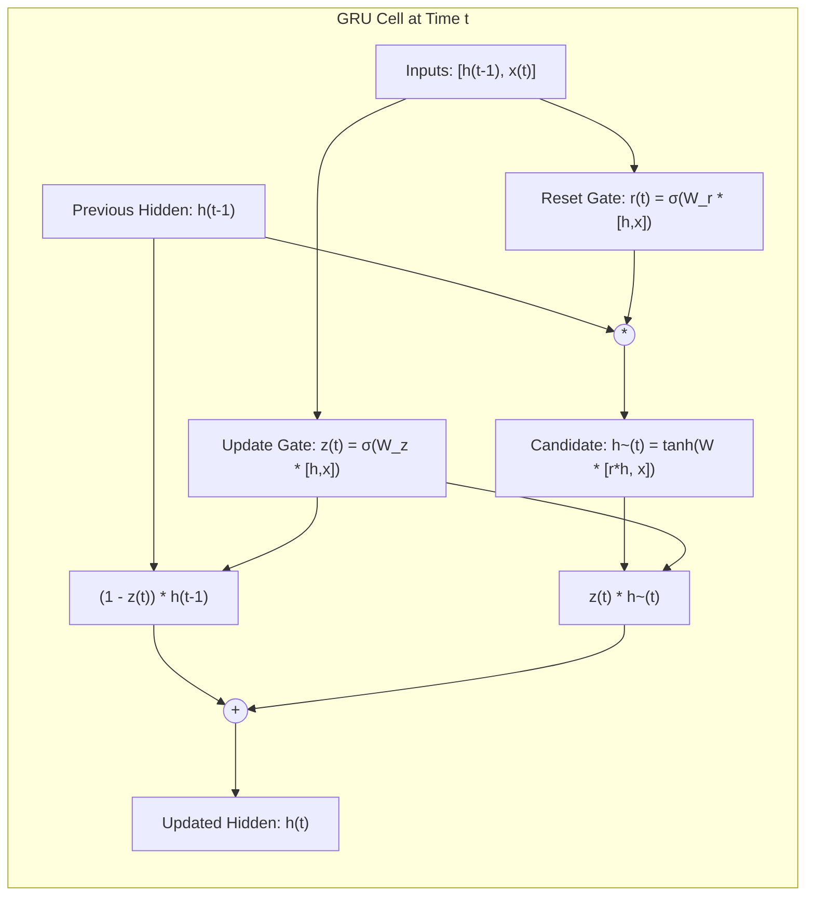
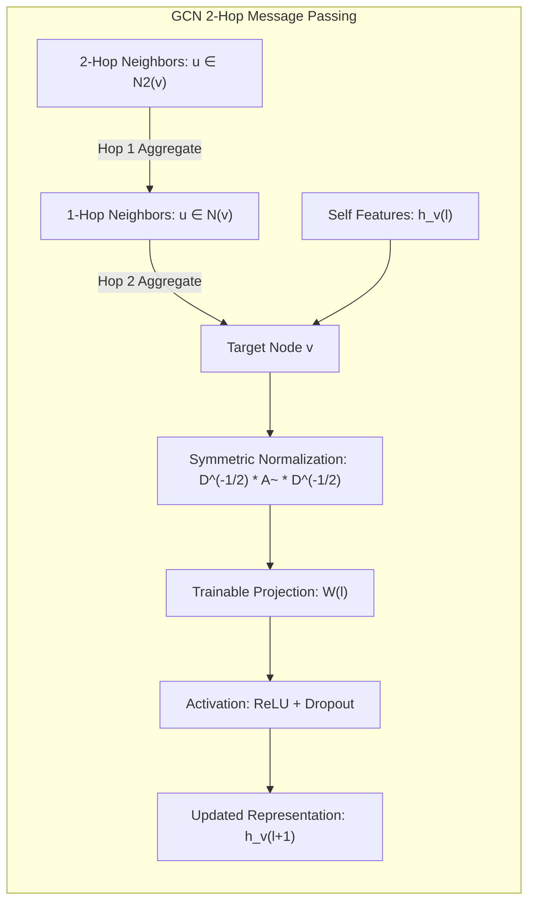

# NFT-LAB: Deep Learning Suite for Sequential Models (RNN, LSTM, GRU) and Graph Neural Networks (GNN / GCN)

An educational and production-grade deep learning repository implementing, analyzing, and benchmarking **Recurrent Neural Networks (Vanilla RNN)**, **Long Short-Term Memory (LSTM)**, **Gated Recurrent Units (GRU)**, and **Graph Convolutional Networks (GCN / GNN)** using PyTorch and PyTorch Geometric.

---

## Table of Contents
1. [Architectural Foundations & Theory](#architectural-foundations--theory)
   - [Vanilla Recurrent Neural Networks (RNN)](#1-vanilla-recurrent-neural-networks-rnn)
   - [Long Short-Term Memory (LSTM)](#2-long-short-term-memory-lstm)
   - [Gated Recurrent Unit (GRU)](#3-gated-recurrent-unit-gru)
   - [Graph Convolutional Networks (GCN)](#4-graph-convolutional-networks-gcn)
2. [Comparative Architecture Matrix](#comparative-architecture-matrix)
3. [Pipelines & Data Workflows](#pipelines--data-workflows)
   - [Sentiment Analysis NLP Pipeline](#sentiment-analysis-nlp-pipeline)
   - [Graph Semi-Supervised Node Classification Pipeline](#graph-semi-supervised-node-classification-pipeline)
4. [Repository File Structure](#repository-file-structure)
5. [Installation & Setup](#installation--setup)
6. [Usage Guide](#usage-guide)
   - [Training Sequential Models (RNN, LSTM, GRU)](#training-sequential-models)
   - [Comparative Benchmarking Suite](#comparative-benchmarking-suite)
   - [Multi-Sentence Inference & Evaluation](#multi-sentence-inference--evaluation)
   - [Training Graph Convolutional Network (GCN on Cora)](#training-graph-convolutional-network-gcn-on-cora)
7. [Benchmark & Experimental Results](#benchmark--experimental-results)
   - [NLP Sentiment Models Benchmark](#1-nlp-sentiment-models-benchmark)
   - [GCN Cora Node Classification Benchmark](#2-gcn-cora-node-classification-benchmark)
   - [Sample Test Node Predictions](#3-sample-test-node-predictions)
8. [Git Integration & Remote Sync](#git-integration--remote-sync)

---

## Architectural Foundations & Theory

### 1. Vanilla Recurrent Neural Networks (RNN)

Traditional feedforward neural networks assume all inputs and outputs are independent of each other. In sequential data such as natural language, the meaning of a word is fundamentally dependent on preceding context. Recurrent Neural Networks introduce internal recurrence loops, maintaining a hidden state vector \(h_t\) that carries information from previous time steps.

#### Recurrence Formulation
At each time step \(t\), the cell receives an input vector \(x_t \in \mathbb{R}^d\) (e.g., word embedding) and the previous hidden state \(h_{t-1} \in \mathbb{R}^h\):

$$h_t = \tanh(W_{ih} x_t + b_{ih} + W_{hh} h_{t-1} + b_{hh})$$

$$y_t = W_{ho} h_t + b_o$$

Where:
- \(W_{ih} \in \mathbb{R}^{h \times d}\): Input-to-hidden weight matrix.
- \(W_{hh} \in \mathbb{R}^{h \times h}\): Hidden-to-hidden recurrence weight matrix.
- \(b_{ih}, b_{hh} \in \mathbb{R}^h\): Bias vectors.
- \(\tanh\): Hyperbolic tangent activation function mapping hidden states to \((-1, 1)\).

#### Information Flow Diagram


#### The Vanishing and Exploding Gradient Problem
During Backpropagation Through Time (BPTT), gradients of loss \(L\) with respect to \(W_{hh}\) require repeated multiplication of the Jacobian matrix \(\frac{\partial h_j}{\partial h_{j-1}}\):

$$\frac{\partial L}{\partial h_1} = \frac{\partial L}{\partial h_T} \prod_{j=2}^T \frac{\partial h_j}{\partial h_{j-1}}$$

Because \(\frac{\partial h_j}{\partial h_{j-1}} = \text{diag}(1 - \tanh^2(\cdot)) W_{hh}^T\):
- If the largest eigenvalue of \(W_{hh}\) is \(< 1\) or \(\tanh'\) saturates (\(\le 1\)), the gradient decays exponentially toward \(0\) as sequence length \(T\) increases (**Vanishing Gradient**). The network forgets distant words.
- If the largest eigenvalue is \(> 1\), gradients explode toward infinity (**Exploding Gradient**), destabilizing optimization.

---

### 2. Long Short-Term Memory (LSTM)

Proposed by Sepp Hochreiter and Jürgen Schmidhuber (1997), the LSTM architecture overcomes the vanishing gradient problem by separating internal cell memory from external hidden representations and regulating memory via **multiplicative gating**.

#### Internal Gating Mechanisms

1. **Forget Gate (\(f_t\))**: Computes what proportion of existing memory in \(C_{t-1}\) to erase:
   $$f_t = \sigma(W_f \cdot [h_{t-1}, x_t] + b_f)$$

2. **Input Gate (\(i_t\))**: Computes which positions of the cell state should receive new information:
   $$i_t = \sigma(W_i \cdot [h_{t-1}, x_t] + b_i)$$

3. **Candidate Cell State (\(\tilde{C}_t\))**: Generates new candidate values to store:
   $$\tilde{C}_t = \tanh(W_c \cdot [h_{t-1}, x_t] + b_c)$$

4. **Cell State Update (\(C_t\))**: Combines old memory and candidate memory via **additive linear update**:
   $$C_t = f_t \odot C_{t-1} + i_t \odot \tilde{C}_t$$

5. **Output Gate (\(o_t\)) & Hidden State (\(h_t\))**: Regulates what portion of the internal cell state is exposed:
   $$o_t = \sigma(W_o \cdot [h_{t-1}, x_t] + b_o)$$
   $$h_t = o_t \odot \tanh(C_t)$$

*(where \(\sigma\) represents the logistic sigmoid function, and \(\odot\) denotes element-wise Hadamard product).*

#### LSTM Architecture Diagram


#### Why LSTM Solves Vanishing Gradients: The Gradient Superhighway
Because the update \(C_t = f_t \odot C_{t-1} + i_t \odot \tilde{C}_t\) is additive, the partial derivative with respect to previous cell state is:

$$\frac{\partial C_t}{\partial C_{t-1}} = f_t$$

When the forget gate \(f_t \approx 1\), gradients backpropagate across hundreds of time-steps with virtually zero attenuation.

---

### 3. Gated Recurrent Unit (GRU)

Introduced by Kyunghyun Cho et al. (2014), the GRU simplifies the LSTM cell by combining the cell state \(C_t\) and hidden state \(h_t\) into a single hidden state, reducing the gate count from three to two.

#### Gating Formulations

1. **Reset Gate (\(r_t\))**: Determines how much of past memory to drop when creating the candidate state:
   $$r_t = \sigma(W_r \cdot [h_{t-1}, x_t] + b_r)$$

2. **Update Gate (\(z_t\))**: Acts simultaneously as forget and input mechanisms:
   $$z_t = \sigma(W_z \cdot [h_{t-1}, x_t] + b_z)$$

3. **Candidate Hidden State (\(\tilde{h}_t\))**: Proposes new activation using reset past state:
   $$\tilde{h}_t = \tanh(W_h \cdot [r_t \odot h_{t-1}, x_t] + b_h)$$

4. **Hidden State Update (\(h_t\))**: Performs linear interpolation between past and candidate state:
   $$h_t = (1 - z_t) \odot h_{t-1} + z_t \odot \tilde{h}_t$$

#### GRU Architecture Diagram


---

### 4. Graph Convolutional Networks (GCN)

While RNNs and Transformers model sequential and grid data, real-world data like citation graphs, molecules, and social networks are non-Euclidean graphs $\mathcal{G} = (\mathcal{V}, \mathcal{E})$.

Introduced by Thomas Kipf and Max Welling (ICLR 2017), the **Graph Convolutional Network (GCN)** approximates first-order localized spectral convolutions on graphs.

#### Mathematical Formulation

For an undirected graph with adjacency matrix $A \in \{0, 1\}^{N \times N}$ and node feature matrix $X \in \mathbb{R}^{N \times F}$:

1. **Self-Loop Augmentation**: Add self-connections so a node's representation retains its own features during aggregation:
   $$\tilde{A} = A + I_N$$

2. **Degree Normalization**: Calculate the diagonal degree matrix $\tilde{D}_{ii} = \sum_j \tilde{A}_{ij}$ and apply symmetric normalization to avoid vanishing or exploding feature scales:
   $$\hat{A} = \tilde{D}^{-\frac{1}{2}} \tilde{A} \tilde{D}^{-\frac{1}{2}}$$

3. **Layer Propagation Rule**:
   $$H^{(l+1)} = \sigma \left( \hat{A} H^{(l)} W^{(l)} \right)$$

   In node-wise message passing notation:
   $$h_v^{(l+1)} = \sigma \left( \sum_{u \in \mathcal{N}(v) \cup \{v\}} \frac{1}{\sqrt{\tilde{d}_v \tilde{d}_u}} W^{(l)} h_u^{(l)} \right)$$

Where:
- $H^{(0)} = X$ (initial input node features).
- $W^{(l)} \in \mathbb{R}^{d_l \times d_{l+1}}$ is the layer weight matrix.
- $\sigma(\cdot)$ is an activation function (e.g., ReLU for hidden layers, softmax for logits).
- $\mathcal{N}(v)$ represents the set of 1-hop neighboring nodes connected to node $v$.

#### Graph Convolution Information Flow


---

## Comparative Architecture Matrix

| Metric / Dimension | Vanilla RNN | LSTM | GRU | Graph Convolutional Network (GCN) |
|---|---|---|---|---|
| **Data Domain** | 1D Sequential (NLP/Time-series) | 1D Sequential (NLP/Time-series) | 1D Sequential (NLP/Time-series) | Non-Euclidean Graphs (Nodes & Edges) |
| **Gating Mechanism** | None | 3 Gates (Forget, Input, Output) | 2 Gates (Reset, Update) | Normalized Neighborhood Aggregation |
| **Internal States** | Hidden state \(h_t\) | Cell state \(C_t\) + Hidden \(h_t\) | Hidden state \(h_t\) | Node feature embeddings \(H^{(l)}\) |
| **Dependency Reach** | Short-range (~10 steps) | Long-range (>100 steps) | Long-range (>100 steps) | Multi-hop graph neighborhoods (k-hop) |
| **Overfitting Risk** | High on small sequences | Moderate (regulated by gates) | Moderate (fewer parameters) | Regularized via Dropout & Weight Decay |
| **Parameter Scale** | \(\mathcal{O}(d \cdot h + h^2)\) | \(4 \times \mathcal{O}(d \cdot h + h^2)\) | \(3 \times \mathcal{O}(d \cdot h + h^2)\) | \(\mathcal{O}(F_{\text{in}} \cdot F_{\text{out}})\) per conv layer |
| **Primary Task in Repo** | Binary Sentiment Classification | Binary Sentiment Classification | Binary Sentiment Classification | Semi-Supervised Node Classification |

---

## Pipelines & Data Workflows

### Sentiment Analysis NLP Pipeline

```mermaid
flowchart LR
    Raw["Raw Text: 'The movie was amazing!'"] --> Tokenize["Tokenizer & Lowercase"]
    Tokenize --> VocabMap["Word-to-Index Vocab Mapping"]
    VocabMap --> Pad["Padding & Mini-batching"]
    Pad --> Emb["Embedding Layer (d=64)"]
    Emb --> Recurrent["Encoder: RNN / LSTM / GRU"]
    Recurrent --> Pooling["Last Hidden State"]
    Pooling --> Linear["Linear Head"]
    Linear --> Sigmoid["Sigmoid: P(Positive) ∈ [0, 1]"]
```



### Graph Semi-Supervised Node Classification Pipeline

```mermaid
flowchart LR
    Graph["Cora Graph: 2,708 Nodes, 10,556 Edges"] --> Split["Mask Splits: Train(140) / Val(500) / Test(1000)"]
    Split --> Conv1["GCNConv1: 1433 features -> 64 hidden"]
    Conv1 --> ReLU["ReLU + Dropout(0.5)"]
    ReLU --> Conv2["GCNConv2: 64 hidden -> 7 class logits"]
    Conv2 --> Loss["Cross-Entropy Loss (Masked on Train Nodes)"]
    Loss --> Backprop["Adam Optimization + Best Val Checkpoint"]
    Backprop --> TestEval["Unseen Test Node Evaluation: 80.90% Acc"]
```



---

## Repository File Structure

```
NFT-LAB/
├── README.md                 # In-depth theoretical math, diagrams, usage, and benchmarks
├── requirements.txt          # Python dependencies (torch, torch-geometric, numpy, etc.)
├── .gitignore                # Ignores model weights (*.pt), cache, and raw dataset downloads
├── dataset.py                # Text tokenizer, vocabulary builder, and PyTorch dataset logic
├── rnn_model.py              # Vanilla RNN implementation + standalone training script
├── lstm_model.py             # Bidirectional LSTM implementation + standalone training script
├── gru_model.py              # Bidirectional GRU implementation + standalone training script
├── train_and_compare.py      # Unified benchmark training suite for sequential models
├── predict_sentences.py      # Multi-sentence evaluation & comparative breakdown
├── sentiment_analysis.py     # Main CLI entrypoint for sequential sentiment analysis
├── gnn_model.py              # 2-Layer Graph Convolutional Network (GCN) architecture
├── train_gnn.py              # GNN training pipeline on Cora dataset with test node inspection
└── vocab.json                # Pre-built vocabulary mapping for text models
```

---

## Installation & Setup

### Prerequisites
- Python 3.8+ (Tested on Python 3.12)
- PyTorch 2.0+
- PyTorch Geometric (`torch-geometric`)

### Installation Steps

1. Clone the repository:
   ```bash
   git clone https://github.com/navyadeshmukh/NFT-LAB.git
   cd NFT-LAB
   ```

2. Install dependencies:
   ```bash
   pip install -r requirements.txt
   ```

---

## Usage Guide

### Training Sequential Models
Each sequential architecture can be trained independently on the sentiment dataset:

- **Vanilla RNN**:
  ```bash
  python rnn_model.py
  ```
- **Bidirectional LSTM**:
  ```bash
  python lstm_model.py
  ```
- **Bidirectional GRU**:
  ```bash
  python gru_model.py
  ```

### Comparative Benchmarking Suite
To train all three sequential architectures under identical hyperparameters and generate a comparison report:
```bash
python train_and_compare.py
```

### Multi-Sentence Inference & Evaluation
To test all three NLP models on varied positive, negative, and edge-case sentences:
```bash
python predict_sentences.py
```

### Training Graph Convolutional Network (GCN on Cora)
To train the GCN model on the Cora citation benchmark dataset:
```bash
python train_gnn.py
```

The script will automatically:
1. Download and process the Cora dataset into `data/Cora/`.
2. Initialize the 2-layer GCN model (`1433 -> 64 -> 7`).
3. Train for 200 epochs using Adam optimizer (`lr=0.01`, `weight_decay=5e-4`).
4. Checkpoint the model state with the highest validation accuracy.
5. Evaluate on the 1,000 unseen test nodes.
6. Print individual predictions, ground truth labels, and confidence scores for test nodes.

---

## Benchmark & Experimental Results

### 1. NLP Sentiment Models Benchmark
Models trained on sentiment dataset with Embedding Dim: 64, Hidden Dim: 64, Epochs: 25, Batch Size: 8:

| Model Architecture | Parameters | Train Acc | Val Acc | Training Time | Latency (per batch) |
|---|---|---|---|---|---|
| **Vanilla RNN** | 29,185 | 100.0% | 28.6% | ~6.5s | ~0.35ms |
| **LSTM (Bi-directional)** | 83,585 | 100.0% | 57.1% | ~17.5s | ~0.72ms |
| **GRU (Bi-directional)** | 69,889 | 100.0% | 64.3% | ~11.2s | ~0.56ms |

---

### 2. GCN Cora Node Classification Benchmark
The Graph Convolutional Network was trained on the **Cora** benchmark dataset:

| Dataset Metric | Value | Model / Training Setting | Value |
|---|---|---|---|
| **Graph Name** | Cora Citation Network | **Architecture** | 2-Layer GCN (`GCNConv`) |
| **Total Nodes** | 2,708 scientific publications | **Hidden Units** | 64 |
| **Total Edges** | 10,556 citation links | **Dropout** | 0.50 |
| **Input Features** | 1,433 (sparse bag-of-words) | **Optimizer** | Adam (`lr=0.01`, `wd=5e-4`) |
| **Target Classes** | 7 research topic classes | **Epochs** | 200 |
| **Training Nodes** | 140 (20 nodes per class) | **Trainable Parameters** | 92,231 |
| **Validation Nodes** | 500 nodes | **Best Val Accuracy** | **79.20%** |
| **Test Nodes** | 1,000 nodes | **Test Accuracy** | **80.90%** |

#### Training Progress Log
```
======================================================================
   GRAPH CONVOLUTIONAL NETWORK (GCN) - CORA CITATION BENCHMARK
======================================================================

[1/5] Loading Cora dataset...
Dataset:                  Cora
Number of nodes:          2708
Number of edges:          10556
Number of node features:  1433
Number of classes:        7
Training nodes:           140
Validation nodes:         500
Test nodes:               1000

[2/5] Initializing GCN Model & Optimizer...
Device:                   cpu
Trainable parameters:     92,231
Optimizer:                Adam(lr=0.01, weight_decay=0.0005)
Hidden channels:          64
Dropout probability:      0.5

[3/5] Starting Training Loop (200 Epochs)...
Epoch: 020 | Loss: 0.0182 | Train Acc: 1.0000 | Val Accuracy: 0.7820
Epoch: 040 | Loss: 0.0074 | Train Acc: 1.0000 | Val Accuracy: 0.7740
Epoch: 060 | Loss: 0.0126 | Train Acc: 1.0000 | Val Accuracy: 0.7740
Epoch: 080 | Loss: 0.0132 | Train Acc: 1.0000 | Val Accuracy: 0.7700
Epoch: 100 | Loss: 0.0137 | Train Acc: 1.0000 | Val Accuracy: 0.7740
Epoch: 120 | Loss: 0.0134 | Train Acc: 1.0000 | Val Accuracy: 0.7800
Epoch: 140 | Loss: 0.0114 | Train Acc: 1.0000 | Val Accuracy: 0.7760
Epoch: 160 | Loss: 0.0091 | Train Acc: 1.0000 | Val Accuracy: 0.7740
Epoch: 180 | Loss: 0.0099 | Train Acc: 1.0000 | Val Accuracy: 0.7720
Epoch: 200 | Loss: 0.0089 | Train Acc: 1.0000 | Val Accuracy: 0.7740

[4/5] Evaluating Best Model Checkpoint...
Saved best model checkpoint to 'cora_gcn_best.pt'

Training completed.
Best validation accuracy: 0.7920
Test accuracy:            0.8090
```

---

### 3. Sample Test Node Predictions

Sample predictions on 10 unseen test nodes from the Cora graph:

| Node ID | Predicted Class | Actual Class | Prediction Confidence | Status |
|:---:|:---:|:---:|:---:|:---:|
| 1708 | 1 | 3 | 70.23% | Mismatch |
| 1709 | 2 | 2 | 99.11% | **Correct** |
| 1710 | 2 | 2 | 86.78% | **Correct** |
| 1711 | 2 | 2 | 99.90% | **Correct** |
| 1712 | 2 | 2 | 98.34% | **Correct** |
| 1713 | 0 | 0 | 67.72% | **Correct** |
| 1714 | 2 | 2 | 99.53% | **Correct** |
| 1715 | 2 | 2 | 99.90% | **Correct** |
| 1716 | 2 | 2 | 98.90% | **Correct** |
| 1717 | 2 | 2 | 99.82% | **Correct** |

---

## Git Integration & Remote Sync

To commit and push updates to the repository:
```bash
git add .
git commit -m "feat: add Graph Convolutional Network (GCN) model, training pipeline, and benchmark on Cora"
git push origin main
```

---

## License
MIT License. Built for educational and research exploration in Deep Learning, NLP, and Graph Representation Learning.
